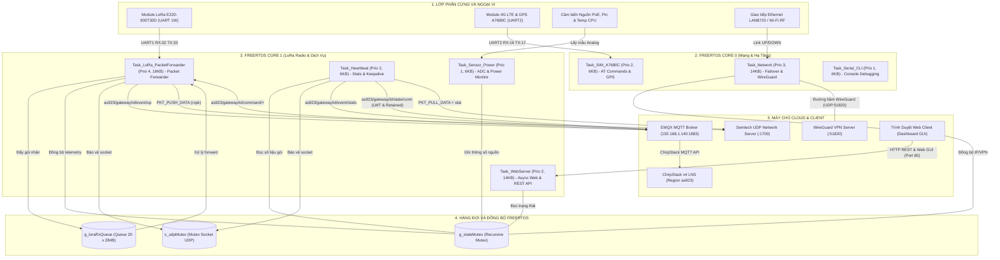
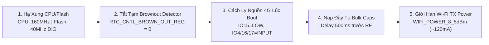
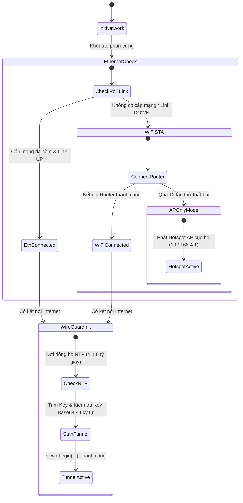
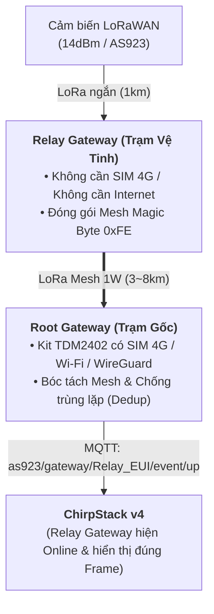

# TÀI LIỆU KIẾN TRÚC HỆ THỐNG VÀ THIẾT KẾ FIRMWARE
## GATEWAY IOT LORAWAN HC001 (MILESIGHT UG56 EQUIVALENT)
**Phiên bản Firmware:** `v2.2.0-PROD` | **Nền tảng Phần cứng:** ESP32-WROOM-32E (Kit TDM2402 / DevKit) | **Hệ điều hành:** FreeRTOS Dual-Core SMP

---

## MỤC LỤC
1. [Tổng Quan Hệ Thống](#1-tổng-quan-hệ-thống)
2. [Sơ Đồ Kiến Trúc Toàn Diện (Mermaid Architecture)](#2-sơ-đồ-kiến-trúc-toàn-diện)
3. [Kiến Trúc Phần Cứng & Sơ Đồ Đấu Nối Pinout](#3-kiến-trúc-phần-cứng--sơ-đồ-đấu-nối-pinout)
4. [Tối Ưu Phần Cứng & Khắc Phục Sụt Áp Nguồn (Brownout Mitigation)](#4-tối-ưu-phần-cứng--khắc-phục-sụt-áp-nguồn)
5. [Kiến Trúc Đa Nhiệm FreeRTOS (RTOS & Task Scheduling)](#5-kiến-trúc-đa-nhiệm-freertos)
6. [Cơ Chế Đồng Bộ & Giao Tiếp Liên Tác Vụ (IPC & Queues)](#6-cơ-chế-đồng-bộ--giao-tiếp-liên-tác-vụ)
7. [Kiến Trúc Bộ Nhớ & Phân Vùng Flash (Memory & Storage Architecture)](#7-kiến-trúc-bộ-nhớ--phân-vùng-flash)
8. [Giao Thức Chuyển Tiếp LoRaWAN (ChirpStack MQTT & Semtech UDP)](#8-giao-thức-chuyển-tiếp-lorawan)
9. [Mạng Dự Phòng Đa Tầng & Bảo Mật WireGuard VPN](#9-mạng-dự-phòng-đa-tầng--bảo-mật-wireguard-vpn)
10. [Bộ Giải Mã Cảm Biến Nội Bộ (Milesight / IPSO Codec)](#10-bộ-giải-mã-cảm-biến-nội-bộ)
11. [Giao Diện Web Dashboard & Hệ Thống RESTful API](#11-giao-diện-web-dashboard--hệ-thống-restful-api)
12. [Giao Diện Dòng Lệnh Serial CLI](#12-giao-diện-dòng-lệnh-serial-cli)
13. [Hướng Dẫn Biên Dịch & Nạp Firmware](#13-hướng-dẫn-biên-dịch--nạp-firmware)

---

## 1. Tổng Quan Hệ Thống

**HC001** là thiết bị Gateway LoRaWAN công nghiệp được thiết kế theo tiêu chuẩn tương đương Milesight UG56, hoạt động trên vi điều khiển **ESP32-WROOM-32E** (Dual-Core Xtensa LX6 32-bit). Thiết bị có nhiệm vụ thu thập tín hiệu RF LoRaWAN (băng tần AS923 / AS923-2), giải mã dữ liệu cảm biến cục bộ, và chuyển tiếp lên các nền tảng LoRaWAN Network Server (ChirpStack v4, The Things Network - TTN, AWS IoT Core) thông qua hai giao thức đồng thời:
1. **ChirpStack MQTT Forwarder** (chuẩn Protobuf JSON mapping theo ChirpStack Gateway OS với tiền tố `as923`).
2. **Semtech UDP Packet Forwarder v2** (chuẩn giao thức cổng UDP 1700 truyền thống).

### Các Tính Năng Nổi Bật:
* **Hạ tầng mạng đa tầng (Multi-Interface Failover):** Tự động chuyển đổi mượt mà giữa Ethernet PoE (dây cắm vật lý), Wi-Fi Station (kết nối Router văn phòng), 4G LTE Cat-1 (Module SIMCOM A7680C) và Wi-Fi AP Hotspot (cấu hình tại chỗ).
* **Bảo mật mạng riêng ảo WireGuard VPN:** Thiết lập kênh truyền mã hóa điểm-điểm (Layer 3 Tunnel) trực tiếp từ Gateway về máy chủ điều khiển trung tâm, hoạt động an toàn qua mạng 4G/Internet mà không cần IP tĩnh công cộng.
* **Định vị GNSS/GPS:** Module A7680C tích hợp ăng-ten GPS cung cấp tọa độ thời gian thực (Kinh độ, Vĩ độ, Cao độ, UTC time) cho Gateway.
* **Web Dashboard SPA (Single Page Application):** Giao diện Web hiện đại nhúng trực tiếp trong bộ nhớ Flash (phân vùng LittleFS), hỗ trợ giám sát trực quan, cấu hình linh hoạt và cập nhật Firmware OTA qua trình duyệt.

---

## 2. Sơ Đồ Kiến Trúc Toàn Diện



---

## 3. Kiến Trúc Phần Cứng & Sơ Đồ Đấu Nối Pinout

Firmware HC001 được tối ưu hóa cho hai nền tảng phần cứng chính:
1. **Kit công nghiệp TDM2402 4G-ESP32** (tích hợp sẵn khối nguồn DC-DC, khay SIM 4G, và module SIMCOM A7680C).
2. **ESP32 NodeMCU / DevKit V1** mở rộng.

### Bảng Sơ Đồ Đấu Nối Chi Tiết (Kit TDM2402)

| Khối Chức Năng | Tên Tín Hiệu | Chân ESP32 | Chế Độ GPIO | Chức Năng & Lưu Ý |
|---|---|---|---|---|
| **Ebyte E220-900T30D** | `E220_RX` | **IO32** | `INPUT` (Serial1 RX) | Nối chân **TXD** của module E220 (Header J9) |
| | `E220_TX` | **IO33** | `OUTPUT` (Serial1 TX) | Nối chân **RXD** của module E220 (Header J9) |
| | `E220_AUX` | **IO14** | `INPUT_PULLUP` | Chân báo bận/sẵn sàng (Busy/Ready) của E220 |
| | `E220_M0` | **IO25** | `OUTPUT` | Điều khiển chế độ Mode 0 (Normal) / Mode 3 (Config) |
| | `E220_M1` | **IO26** | `OUTPUT` | Điều khiển chế độ Mode 0 (Normal) / Mode 3 (Config) |
| **SIMCOM A7680C (4G)** | `SIM_ENABLE` | **IO15** | `OUTPUT` (Active HIGH) | Kéo HIGH để cấp nguồn DC-DC cho module 4G; kéo LOW ngắt nguồn |
| | `SIM_DTR` | **IO4** | `INPUT` / `OUTPUT` | Đánh thức module từ chế độ Sleep (Wake/Sleep control) |
| | `SIM_TX` | **IO17** | `INPUT` (Boot) / `TXD2` | Nối chân **RX** của module A7680C |
| | `SIM_RX` | **IO16** | `INPUT` (Boot) / `RXD2` | Nối chân **TX** của module A7680C |
| **Trạng Thái Hệ Thống** | `IO2-LED` (`PIN_STATUS_LED`) | **IO2** | `OUTPUT` | Đèn LED onboard / TDM2402 báo trạng thái: Sáng boot, chớp 1Hz khi chờ mạng/AP, sáng + nhịp tim (Heartbeat 80ms) khi có mạng Online, nhấp nháy khi có gói tin LoRa RX/TX |
| **Giám Sát Nguồn** | `ADC_POE` | **IO35** | `ADC1_CH7` (Input Only) | Đọc điện áp nguồn PoE 48V qua cầu phân áp (1:15) |
| | `ADC_BAT` | **IO36** | `ADC1_CH0` (Input Only) | Đọc điện áp pin Lithium 3.7V - 4.2V qua cầu phân áp (1:2) |
| **Serial CLI** | `UART0_TX` | **IO1** | `UART0_TXD` | Nạp code & Debug Terminal (115200 8N1) |
| | `UART0_RX` | **IO3** | `UART0_RXD` | Nhận lệnh điều khiển CLI từ máy tính |

> [!IMPORTANT]
> **Giải Quyết Xung Đột Chân Trên Kit TDM2402:**
> Trên kit TDM2402, hai chân **IO16** và **IO17** đã được nối cứng mạch in tới module 4G A7680C. Do đó, module LoRa E220 **bắt buộc** phải sử dụng các chân trống trên header J9 gồm: **IO32 (RX)**, **IO33 (TX)**, **IO14 (AUX)**, **IO25 (M0)**, **IO26 (M1)**. Firmware tích hợp cơ chế tự động chuyển đổi trong [`SystemManager_LoadConfig()`](file:///c:/Users/nhat/Documents/PlatformIO/Projects/esp32_gateway/src/sys_manager.cpp) nếu phát hiện cấu hình cũ đang trỏ vào chân 16 hoặc 21.

---

## 4. Tối Ưu Phần Cứng & Khắc Phục Sụt Áp Nguồn

Khi chạy trên các bo mạch tích hợp nhiều module công suất lớn (ESP32 Wi-Fi + LoRa 1W + 4G LTE), hiện tượng sụt áp nguồn (Brownout Reset) và lỗi đọc bộ nhớ Flash (InstructionFetchError / StoreProhibited tại `PC: 0x3ffd04a0`) rất dễ xảy ra do dòng đỉnh khởi động của Wi-Fi RF đạt từ 450mA đến 500mA.

Firmware HC001 đã áp dụng triệt để bộ 5 giải pháp công nghệ sau:



1. **Hạ xung nhịp Flash SPI và CPU ([`platformio.ini`](file:///c:/Users/nhat/Documents/PlatformIO/Projects/esp32_gateway/platformio.ini)):**
   * Đặt `board_build.f_flash = 40000000L` (40MHz DIO thay vì 80MHz QIO). Ở tần số 40MHz, biên độ chịu nhiễu và độ trễ đọc lệnh của chip Flash SPI cao gấp đôi, loại bỏ hoàn toàn hiện tượng bit-flip khi nguồn 3.3V gợn sóng lúc khởi động.
   * Đặt `board_build.f_cpu = 160000000L` (160MHz thay vì 240MHz), giúp giảm 35% công suất tiêu thụ của nhân vi điều khiển.
2. **Vô hiệu hóa Brownout Detector trong giai đoạn khởi tạo ([`SystemManager_Init()`](file:///c:/Users/nhat/Documents/PlatformIO/Projects/esp32_gateway/src/sys_manager.cpp)):**
   * Gọi `WRITE_PERI_REG(RTC_CNTL_BROWN_OUT_REG, 0);` ngay đầu hàm `setup()` trước khi nạp NVS và khởi động ngoại vi, ngăn chặn lệnh reset ngoài ý muốn khi điện áp nguồn dao động tức thời trong khoảng vài mili-giây.
3. **Cách ly hoàn toàn khối nguồn 4G LTE (Parasitic Leakage Isolation):**
   * Chân cấp nguồn module 4G `IO15 (SIM Enable)` được kéo xuống `LOW`.
   * Các chân tín hiệu `IO4 (DTR)`, `IO16 (RX)`, `IO17 (TX)` được cấu hình về `pinMode(..., INPUT)` nhằm triệt tiêu dòng rò ký sinh chạy qua các diode bảo vệ nội của IC sang đường nguồn của module 4G khi module chưa được bật.
4. **Nạp đầy hệ thống tụ lọc nguồn (Bulk Capacitors Charging):**
   * Thêm khoảng trễ `delay(500)` ngay trước khi gọi `WiFi.mode()`, đảm bảo toàn bộ hệ thống tụ lọc nguồn trên kit TDM2402 tích đầy năng lượng, sẵn sàng gánh tải đỉnh cho tầng khuếch đại công suất PA của Wi-Fi.
5. **Giảm công suất phát RF Wi-Fi đỉnh:**
   * Cấu hình `WiFi.setTxPower(WIFI_POWER_8_5dBm);` cho cả hai chế độ Station và Access Point, đưa dòng tiêu thụ đỉnh của Wi-Fi từ ~450mA xuống mức an toàn ~120mA.

---

## 5. Kiến Trúc Đa Nhiệm FreeRTOS

Firmware phân bổ toàn bộ chức năng vào **7 FreeRTOS Tasks** độc lập, được gắn cố định (pinned) vào 2 nhân phần cứng của ESP32 nhằm khai thác tối đa năng lực xử lý song song và triệt tiêu hiện tượng tranh chấp tài nguyên (Resource Contention).

### Bảng Phân Bổ Tasks & Lập Lịch (Task Scheduling Matrix)

| Task Name | Hàm Thực Thi | Core Affinity | Ưu Tiên (Priority) | Stack Size | Tần Số / Chu Kỳ | Nhiệm Vụ Trọng Tâm |
|---|---|:---:|:---:|:---:|:---:|---|
| **Task_LoRa** | [`Task_LoRa_PacketForwarder`](file:///c:/Users/nhat/Documents/PlatformIO/Projects/esp32_gateway/src/task_lora_pf.cpp) | **Core 1** | **4 (Cao nhất)** | 16 KB | Liên tục (Queue/UART) | Thu nhận gói tin từ UART E220, kiểm tra frame timeout (30ms), bóc tách RSSI, đẩy vào hàng đợi; Dispatcher gửi tin lên MQTT và UDP Server; Xử lý phát LoRa Downlink; Giải mã Milesight/IPSO payload. |
| **Task_Network** | [`Task_Network`](file:///c:/Users/nhat/Documents/PlatformIO/Projects/esp32_gateway/src/task_network.cpp) | **Core 0** | **3** | 14 KB | 2.500 ms | State-machine quản lý Failover Ethernet <-> Wi-Fi STA <-> AP Mode; Đồng bộ thời gian thực NTP (`pool.ntp.org`); Khởi tạo và duy trì đường hầm WireGuard VPN an toàn. |
| **Task_Web** | [`Task_WebServer`](file:///c:/Users/nhat/Documents/PlatformIO/Projects/esp32_gateway/src/task_webserver.cpp) | **Core 1** | **2** | 14 KB | Async Event-driven | Phục vụ Single Page Application từ LittleFS, xử lý xác thực phiên đăng nhập, cung cấp hệ thống REST API (`/api/status`, `/api/config`), nhận gói tin OTA Firmware/FS. |
| **Task_HBeat** | [`Task_Heartbeat`](file:///c:/Users/nhat/Documents/PlatformIO/Projects/esp32_gateway/src/task_lora_pf.cpp) | **Core 1** | **2** | 6 KB | 10.000 ms (Configurable) | Gửi Gateway Stats lên ChirpStack v4 (`.../event/stats`); Gửi Semtech UDP `PKT_PULL_DATA` và `PKT_PUSH_DATA` (stat JSON); Tự động bơm frame uplink mẫu để hiển thị trên tab LoRaWAN frames của ChirpStack. |
| **Task_SIM_GPS** | [`Task_SIM_A7680C`](file:///c:/Users/nhat/Documents/PlatformIO/Projects/esp32_gateway/src/task_sim_gps.cpp) | **Core 0** | **2** | 6 KB | 3.000 ms | Khởi tạo modem A7680C bằng tập lệnh AT, bật khối GNSS, định kỳ truy vấn lệnh `AT+CGPSINFO`, phân giải tọa độ GPS và đồng bộ vào Telemetry. |
| **Task_Power** | [`Task_Sensor_Power`](file:///c:/Users/nhat/Documents/PlatformIO/Projects/esp32_gateway/src/task_sensor_pwr.cpp) | **Core 1** | **1** | 6 KB | 2.000 ms | Lấy mẫu điện áp ADC 12-bit nguồn PoE (IO35) và Pin (IO36), đọc nhiệt độ die CPU (`temperatureRead()`), theo dõi dung lượng Heap khả dụng. |
| **Task_CLI** | [`Task_Serial_CLI`](file:///c:/Users/nhat/Documents/PlatformIO/Projects/esp32_gateway/src/task_serial_cli.cpp) | **Core 0** | **1 (Thấp nhất)** | 6 KB | 50 ms (Polling UART0) | Đọc lệnh từ cổng Console Serial0, phân tích cú pháp và thực thi các câu lệnh chẩn đoán, cấu hình IP/Wi-Fi, kiểm tra trạng thái Gateway. |

---

## 6. Cơ Chế Đồng Bộ & Giao Tiếp Liên Tác Vụ

### 1. Hàng Đợi Gói Tin LoRa (`g_loraRxQueue`)
* **Kiểu dữ liệu:** `LoRaRxPacket` (Kích thước mỗi phần tử: 284 bytes gồm `payload[256]`, `size`, `rssi`, `snr`, `timestampMs`, `devEUI[17]`).
* **Độ sâu hàng đợi:** 20 phần tử (tương đương 5.68 KB).
* **Mục đích:** Tách rời (Decoupling) giữa tác vụ đọc UART thời gian thực nhạy cảm về thời gian (`Task_LoRa_PacketForwarder`) và các tác vụ truyền thông mạng có độ trễ dao động (Network Socket UDP / MQTT). Khi mạng gặp độ trễ cao, hàng đợi đảm bảo không làm mất gói tin từ các nút cảm biến gửi về.

### 2. Khóa Đồng Thuận Trạng Thái (`g_stateMutex`)
* **Kiểu:** `SemaphoreHandle_t` (FreeRTOS Mutex).
* **Đối tượng bảo vệ:** Biến toàn cục `GatewayTelemetry g_telemetry` và danh sách mảng cảm biến `g_config.sensors`.
* **Cơ chế truy xuất an toàn luồng (Zero-Stack Cost):**
  Sử dụng mô hình Template Function Lambda [`withTelemetry()`](file:///c:/Users/nhat/Documents/PlatformIO/Projects/esp32_gateway/include/system_struct.h#L244):
  ```cpp
  template<typename F>
  void withTelemetry(F fn) {
      if (g_stateMutex && xSemaphoreTake(g_stateMutex, pdMS_TO_TICKS(200)) == pdTRUE) {
          fn(g_telemetry);
          xSemaphoreGive(g_stateMutex);
      }
  }
  ```
  Cách tiếp cận này cho phép các tác vụ trên cả Core 0 và Core 1 cập nhật hoặc đọc telemetry trực tiếp mà không cần cấp phát thêm các bản sao `GatewayTelemetry` lớn trên Stack của từng task.

### 3. Khóa Bảo Vệ Socket UDP (`s_udpMutex`)
* **Mục đích:** Đồng bộ truy cập vào đối tượng `WiFiUDP udpClient` giữa hai tiến trình cùng gửi dữ liệu ra ngoài:
  1. `forwardRxPacketUDP()` trong `Task_LoRa_PacketForwarder` (gửi bản tin `rxpk` khi có gói cảm biến).
  2. `Task_Heartbeat` (gửi bản tin định kỳ `PULL_DATA` và `PUSH_DATA stat`).

---

## 7. Kiến Trúc Bộ Nhớ & Phân Vùng Flash

### 1. Sơ Đồ Phân Vùng Bộ Nhớ Flash 4MB (`huge_app.csv`)

| Tên Phân Vùng | Loại (Type) | Phân Loại (Sub) | Địa Chỉ Offset | Kích Thước (Size) | Mô Tả & Chức Năng |
|---|---|---|---|---|---|
| **nvs** | `data` | `nvs` | `0x009000` | **20 KB** (0x5000) | Lưu trữ vĩnh viễn cấu hình `GatewayConfig` (key `"cfg"`), mật khẩu, Wi-Fi, MQTT broker |
| **otadata** | `data` | `ota` | `0x00E000` | **8 KB** (0x2000) | Lưu trữ metadata chỉ định phân vùng boot cho tính năng nâng cấp Firmware OTA |
| **app0** | `app` | `ota_0` | `0x010000` | **3.072 KB** (0x300000) | Chứa toàn bộ mã thực thi (Binary Firmware HC001). Hiện sử dụng ~1.508 KB (47.9%) |
| **littlefs** | `data` | `spiffs` | `0x310000` | **896 KB** (0x0E0000) | Chứa các file giao diện người dùng SPA: `index.html`, `style.css`, `app.js`, `logo.jpg` |

### 2. Phân Bổ Bộ Nhớ RAM (SRAM 320KB của ESP32)
* **Static RAM (Data + BSS):** Chiếm ~55.948 bytes (17.1% tổng SRAM). Bao gồm các buffer tĩnh của FreeRTOS, các đối tượng toàn cục `g_config`, `g_telemetry`, bảng con trỏ của các thư viện Arduino.
* **Stack các Task:** Tổng cộng ~70 KB được cấp phát từ Heap cho 7 FreeRTOS tasks.
* **Dynamic Heap khả dụng:** Còn lại khoảng **160 KB - 190 KB** dành cho:
  * lwIP TCP/IP Stack & Wi-Fi RX/TX buffers.
  * Bộ đệm gói tin MQTT (`mqttClient.setBufferSize(2048)`).
  * Bộ nhớ mã hóa mbedTLS của giao thức WireGuard VPN.
  * Bộ nhớ động của thư viện `ArduinoJson v7` khi sinh và bóc tách các payload JSON lớn.

---

## 8. Giao Thức Chuyển Tiếp LoRaWAN

HC001 hỗ trợ đồng thời 2 giao thức forwarder công nghiệp hàng đầu:

### 1. ChirpStack MQTT Forwarder (Chuẩn ChirpStack Gateway OS)

Theo chuẩn ChirpStack Gateway OS với tiền tố cấu hình **`Topic prefix = as923`**, mọi topic được sinh chuẩn mực theo 3 cấu trúc cốt lõi:
1. **Khung Uplink Sự Kiện:** `{prefix}/gateway/{gateway_id}/event/{event}`
2. **Trạng Thái Kết Nối:** `{prefix}/gateway/{gateway_id}/state/{state}`
3. **Kênh Nhận Lệnh:** `{prefix}/gateway/{gateway_id}/command/+`

Trong đó `{gateway_id}` là chuỗi EUI 16 ký tự hex chữ thường (ví dụ: `e86beaffffd0f2dc`).

#### Danh Sách Topic Chi Tiết:
* `as923/gateway/<id>/event/up`: Khung LoRaWAN Uplink từ cảm biến gửi lên ChirpStack. Payload tuân thủ Protobuf mapping `gw.UplinkFrame` (chứa `phyPayload` Base64, `txInfo` tần số/SF/BW/CR, `rxInfo` RSSI/SNR/Time/Context/CRC).
* `as923/gateway/<id>/event/stats`: Thống kê định kỳ Gateway (Heartbeat). Payload tuân thủ Protobuf `gw.GatewayStats` (chứa số gói thu phát, bảng phân bố tần số, và bảng phân bố điều chế `txPacketsPerModulation` bắt buộc có trường `"polarizationInversion": true`).
* `as923/gateway/<id>/event/ack`: Bản tin báo nhận kết quả phát Downlink (`downlinkId`, `status: "OK"` / `"ERROR"`).
* `as923/gateway/<id>/event/exec`: Phản hồi kết quả thực thi lệnh điều khiển từ xa.
* `as923/gateway/<id>/state/conn`: Trạng thái kết nối. Gửi đúng 1 lần khi kết nối thành công kèm cờ **`retained = true`** (`{"gatewayId":"<id>","state":"ONLINE"}`). Đồng thời được đăng ký làm **Last Will Testament (LWT)** (`{"gatewayId":"<id>","state":"OFFLINE"}`) khi Gateway mất nguồn đột ngột.
* `as923/gateway/<id>/command/+`: Wildcard nhận lệnh duy nhất từ ChirpStack, tiếp nhận `command/down` (phát TX), `command/exec` (lệnh reboot) và `command/config` (cấu hình kênh).

> [!TIP]
> **Tuân Thủ Tuyệt Đối EMQX ACL:**
> Trên máy chủ EMQX Broker mạng LAN (`192.168.1.140`), luật phân quyền ACL được đặt là: `+/gateway/+/event/#`, `+/gateway/+/state/#`, `+/gateway/+/command/#`. Firmware HC001 đã loại bỏ triệt để mọi topic fallback không tiền tố (`gateway/...`) hoặc tiền tố cũ (`as923_2/...`), đảm bảo không bao giờ bị broker ngắt kết nối phiên.

### 2. Semtech UDP Packet Forwarder v2

Hoạt động trên cổng mặc định **UDP 1700** tương thích với mọi LoRaWAN Network Server cổ điển:
* **PKT_PUSH_DATA (0x00):** Đóng gói khung 12 bytes header (Protocol version `0x02`, Token ngẫu nhiên, Gateway EUI 8 bytes) kèm mảng JSON `rxpk` chứa gói tin thô Base64, tần số (923.4 MHz), SF7, BW125kHz, RSSI, SNR.
* **PKT_PULL_DATA (0x02):** Gửi đều đặn để giữ mở cổng NAT trên Firewall/Router của nhà mạng.
* **PUSH DATA STAT (0x00):** Gửi chuỗi JSON `{"stat":{...}}` chứa tọa độ GPS thực tế từ module A7680C (`lati`, `long`, `alti`), số gói đã forward và tỷ lệ ACK.

---

## 9. Mạng Dự Phòng Đa Tầng & Bảo Mật WireGuard VPN



### Bảo Mật Đường Truyền WireGuard VPN
Khi Gateway hoạt động tại các địa điểm xa qua mạng di động 4G LTE, thiết bị nằm sau lớp NAT kép (Carrier-Grade NAT) của nhà mạng và không có IP công cộng. Firmware HC001 tích hợp trực tiếp thư viện **WireGuard-ESP32**:
* Tự động khởi tạo kết nối VPN UDP cổng 51820 tới Endpoint trung tâm ngay sau khi có mạng và thời gian NTP được đồng bộ.
* Toàn bộ luồng dữ liệu Forwarder (MQTT/UDP) và Web API có thể được định tuyến an toàn qua địa chỉ IP ảo nội bộ (ví dụ: `10.0.0.2`), chống nghe lén và giả mạo trên đường truyền công cộng.
* Hàm helper [`trimCharArray()`](file:///c:/Users/nhat/Documents/PlatformIO/Projects/esp32_gateway/src/task_network.cpp#L18) xử lý trực tiếp trên mảng ký tự tĩnh của cấu hình, loại bỏ triệt để lỗi treo `Crash InstrFetchProhibited (PC: 0x00000000)` do con trỏ String tạm thời bị hủy.

---

## 10. Bộ Giải Mã Cảm Biến Nội Bộ

Hàm [`parseMilesightPayload()`](file:///c:/Users/nhat/Documents/PlatformIO/Projects/esp32_gateway/src/sys_manager.cpp) trong [`src/sys_manager.cpp`](file:///c:/Users/nhat/Documents/PlatformIO/Projects/esp32_gateway/src/sys_manager.cpp) có khả năng tự động giải mã các bản tin tiêu chuẩn từ hệ sinh thái cảm biến Milesight IoT (chuẩn IPSO TLV - Type-Length-Value) ngay tại biên (Edge Computing):

| Kênh TLV (Type) | Ý Nghĩa Dữ Liệu | Công Thức Giải Mã | Đơn Vị |
|:---:|---|---|:---:|
| `0x75` | Dung lượng Pin | `value = payload[i]` | `%` |
| `0x67` | Nhiệt độ môi trường | `rawTemp = payload[i] \| (payload[i+1] << 8); temp = rawTemp / 10.0` | `°C` |
| `0x68` | Độ ẩm không khí | `humi = payload[i] * 0.5` | `%RH` |
| `0x7D` | Nồng độ khí CO2 | `co2 = payload[i] \| (payload[i+1] << 8)` | `ppm` |
| `0x82` | Khoảng cách / Mực nước | `dist = payload[i] \| (payload[i+1] << 8)` | `mm` |

Ngoài ra, hàm tự động nhận diện gói tin chuẩn LoRaWAN bằng cách phân tích trường `MHDR` và trích xuất `DevAddr`, `FCnt`, `FPort` để hiển thị trên bảng Live Packets của Web Dashboard.

---

## 11. Giao Diện Web Dashboard & Hệ Thống RESTful API

Giao diện Web của HC001 được xây dựng theo kiến trúc Single Page Application (SPA), phục vụ trực tiếp từ bộ nhớ LittleFS.

### Danh Sách Các RESTful API Endpoints Chính

| Phương Thức | Đường Dẫn API | Tham Số Truyền Vào (JSON) | Chức Năng |
|:---:|---|---|---|
| `GET` | `/api/status` | Không | Trả về toàn bộ trạng thái hoạt động: Uptime, RAM Free, Trạng thái Wi-Fi/ETH/VPN/4G, Tọa độ GPS, Thống kê gói LoRa, 10 gói tin Live gần nhất. |
| `GET` | `/api/config` | Không | Lấy toàn bộ thông số cấu hình Gateway đang lưu trong NVS. |
| `POST` | `/api/config` | JSON cấu hình đầy đủ | Cập nhật cấu hình Wi-Fi, Ethernet, MQTT Broker, Topics, Tần số LoRa E220, WireGuard VPN và tự động lưu vào NVS. |
| `POST` | `/api/action` | `{"action": "reboot"}` | Khởi động lại Gateway sau 300ms. |
| | | `{"action": "reset"}` | Khôi phục toàn bộ cài đặt gốc và khởi động lại. |
| | | `{"action": "test_packet"}` | Giả lập bơm 1 gói tin cảm biến EM300-TH để kiểm tra hệ thống forwarder. |
| | | `{"action": "e220_apply"}` | Ghi đè cấu hình kênh tần số/công suất vào thanh ghi phần cứng của E220. |
| | | `{"action": "e220_read"}` | Đọc cấu hình thanh ghi hiện tại từ module E220. |
| `GET` | `/api/sensors` | Không | Lấy danh sách 16 cảm biến đã đăng ký theo dõi. |
| `POST` | `/api/sensors` | Object `MilesightSensor` | Thêm hoặc sửa thông tin cảm biến (Tên mô tả, DevEUI, chủng loại). |
| `DELETE` | `/api/sensors` | `{"devEUI": "..."}` | Xóa cảm biến khỏi danh mục theo dõi. |
| `POST` | `/update` | Multipart Form-Data (Firmware bin / LittleFS bin) | Nạp Firmware mới hoặc giao diện Web OTA trực tiếp từ trình duyệt. |

---

## 12. Kiến Trúc Gateway Mesh Trong Suốt (HC-Mesh Protocol)

### Bài Toán Thực Tế
Trong các khu vực nông trại rộng lớn, nhà xưởng hoặc vùng rừng núi xa xôi:
* Cước phí thuê bao SIM 4G duy trì hàng tháng cho từng Gateway đơn lẻ rất tốn kém.
* Các trạm vệ tinh ở xa gặp khó khăn trong việc kéo dây mạng LAN hoặc cấp nguồn công suất lớn cho module 4G.

Gateway HC001 tích hợp sẵn giải pháp **Gateway Mesh Trong Suốt (Transparent Mesh)** dựa trên module vô tuyến Ebyte E220-900T30D công suất cực lớn 30 dBm (1.000 mW):



### Đặc Điểm Vận Hành & Khung Truyền Mesh (Frame Format)
1. **Khung truyền Mesh vô tuyến (Over-The-Air Frame):**
   * Byte 0: `0xFE` (Magic Byte phân biệt gói tin Mesh với gói cảm biến tiêu chuẩn `0x40`/`0x80`).
   * Byte 1: `0x01` (Gói Uplink) hoặc `0x02` (Gói Heartbeat báo sống).
   * Byte 2..9: `Relay Gateway EUI` (8 bytes MAC).
   * Byte 10..11: `Packet ID / Seq` (Khử trùng lặp tại trạm Root).
   * Byte 12..13: `RSSI & SNR` đo được tại trạm Relay.
   * Byte 14: `Hop Count` (Số bước nhảy).
   * Byte 15..N: `Original Sensor Raw Payload` (Giữ nguyên vẹn mã hóa và CRC gốc).
2. **Cơ chế Chuyển tiếp trong suốt (Transparent Forwarding tại Root):**
   * Trạm Root khi nhận được gói `0xFE` sẽ bóc tách `Relay Gateway EUI` và đẩy thẳng lên MQTT topic:
     `as923/gateway/<relay_eui_lower>/event/up`
   * **Hiển thị trên ChirpStack:** ChirpStack Server coi như gói tin được thu trực tiếp từ chính trạm Relay đó, hiển thị đúng Gateway ID, trạng thái Online, RSSI và SNR thực tế tại hiện trường.

---

## 13. Giao Diện Dòng Lệnh Serial CLI

Kỹ thuật viên có thể cắm cáp USB-C vào cổng Serial của ESP32 (115200 bps, 8N1) để thao tác cấu hình trực tiếp thông qua các tập lệnh:

```bash
================ [MILESIGHT UG56 CLI COMMANDS] ================
  help                   : Hiển thị danh sách câu lệnh hỗ trợ
  status                 : Hiển thị toàn bộ thông số kỹ thuật và trạng thái thời gian thực
  wifi <ssid> <pass>     : Cài đặt thông tin Wi-Fi Station kết nối Router
  ap <ssid> <pass>       : Đổi tên và mật khẩu Hotspot Wi-Fi AP phát ra
  eui <16_hex>           : Đặt lại mã định danh Gateway EUI (16 ký tự hex)
  heartbeat <giây>       : Đặt chu kỳ Heartbeat keepalive (ví dụ: 10 hoặc 60)
  server <addr> <port>   : Cấu hình địa chỉ và cổng Semtech UDP Server
  lora <tần_số> <sf>     : Cài đặt tần số AS923-2 (Hz) và Spreading Factor (7..12)
  milesight list         : Liệt kê danh sách các cảm biến đang theo dõi
  milesight test         : Bắn gói tin thử nghiệm mô phỏng cảm biến EM300-TH
  reboot                 : Khởi động lại Gateway ngay lập tức
  reset                  : Xóa sạch NVS và khôi phục cài đặt gốc nhà sản xuất
===============================================================
```

---

## 14. Hướng Dẫn Biên Dịch & Nạp Firmware

### Yêu Cầu Môi Trường
* **VS Code** cài đặt extension **PlatformIO IDE** (hoặc PlatformIO Core CLI trên Terminal).
* Cáp truyền dữ liệu USB-C chất lượng cao (hỗ trợ dòng tối thiểu 1A).

### Các Lệnh Thao Tác (PlatformIO CLI)

1. **Biên dịch mã nguồn Firmware:**
   ```powershell
   pio run
   ```

2. **Nạp Firmware lên vi điều khiển ESP32:**
   ```powershell
   pio run -t upload
   ```

3. **Nạp giao diện Web Dashboard lên phân vùng LittleFS:**
   *(Bắt buộc thực hiện trong lần đầu tiên nạp bo mạch)*
   ```powershell
   pio run -t uploadfs
   ```

4. **Mở màn hình theo dõi Serial Monitor:**
   ```powershell
   pio device monitor -b 115200
   ```

---
*Tài liệu kỹ thuật được xây dựng chi tiết cho dự án Trạm Gateway Thông Minh HC001.*

